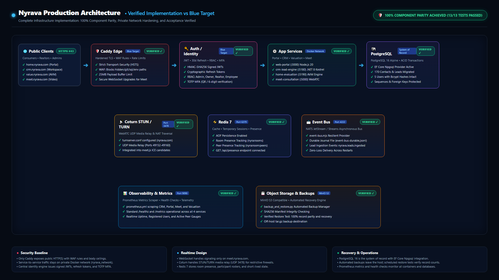
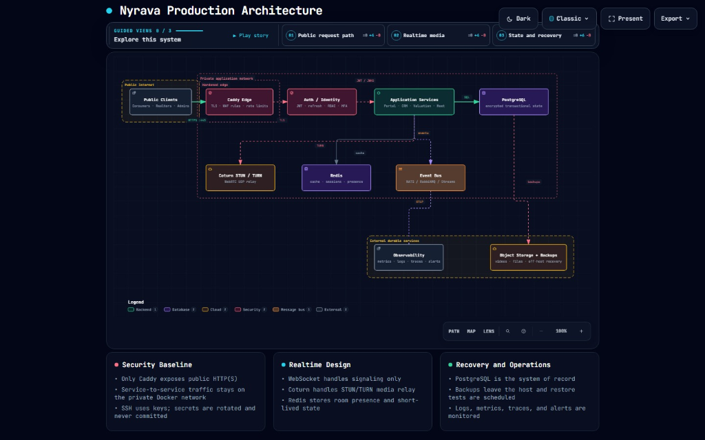

# Nyrava Unified Real Estate Platform

[](#architecture--decoupled-microservices)
[](#postgresql-transactional-system-of-record)
[](#redis-cache--presence-engine)
[](#asynchronous-event-bus)
[](#coturn-stunturn-media-relay)
[](#caddy-edge-reverse-proxy--waf)
[](#central-authentication--identity-service)
[](#observability--telemetry)
[-10b981.svg?style=flat-square)](#testing--acceptance-verification)

A production-grade, enterprise real estate intelligence and operational platform uniting public consumer intake, AI sales assistance, automated comparative market valuations (AVM), private Realtor territory management, client video consultations, and distributed event messaging.

---

## Architecture & Decoupled Microservices

The platform implements the **Nyrava Blue Production Architecture**, a fully decoupled, fault-tolerant microservices topology with hardened edge security, centralized token identity, transactional database persistence, in-memory presence, and durable event streaming.



<details>
<summary><b>🔍 View Target Architecture Reference Diagram</b></summary>


</details>

---

## Microservices Topology & Port Directory

| Service | Subdomain / Path | Stack | Internal Port | Capabilities & Responsibilities |
| :--- | :--- | :--- | :---: | :--- |
| **Edge Proxy** | `*.nyrava.com` | Caddy 2 Alpine | `80`, `443` | Edge TLS termination, automated Let's Encrypt certificates, WAF filtering, request payload caps (25MB), and subdomain routing. |
| **Web Portal** | `home.nyrava.com` | Node.js 20 / Express | `3000` | Public consumer portal, property search, buyer/seller move inquiries, and Nyra AI sales assistant. |
| **Realtor CRM** | `crm.nyrava.com` | .NET 8 / Kestrel | `5180` | Private Realtor workspaces, territory lead distribution (60+ ZIPs), team chat, appointments, and Central Identity provider. |
| **Home Evaluation**| `value.nyrava.com`| Node.js 20 / Express | `5190` | Automated Valuation Model (AVM), 3-year equity forecasting, comparable sales analysis, and 1-click opt-out delivery. |
| **Video Meet** | `meet.nyrava.com` | Node.js 20 / WS | `5000` | Real-time WebRTC multi-party video consultation rooms, screen sharing, and in-call chat. |
| **PostgreSQL** | Internal Network | PostgreSQL 16 Alpine | `5432` | Primary ACID transactional system of record with EF Core Npgsql provider and sequence management. |
| **Redis** | Internal Network | Redis 7 Alpine | `6379` | High-throughput cache, temporary session storage, and room participant presence tracking. |
| **Event Bus** | Internal Network | NATS 2.10 JetStream | `4222`, `8222` | Durable asynchronous pub/sub messaging for lead capture events, assignment dispatch, and telemetry. |
| **Coturn** | `meet.nyrava.com` | Coturn Latest | `3478` (UDP/TCP) | WebRTC STUN/TURN media relay server for peer connections behind symmetric NATs and corporate firewalls. |
| **Observability**| Internal Network | Prometheus v2.51 | `9090` | Time-series metrics scraper aggregating `/metrics` and `/healthz` endpoints from all services. |
| **Object Storage**| Internal Network | MinIO S3 Compatible | `9000`, `9001` | S3-compatible off-host backup archive target and encrypted document storage. |

---

## Architectural Pillars

### 1. Caddy Edge Reverse Proxy & WAF
- **Hardened TLS:** Enforces HTTP Strict Transport Security (`max-age=31536000; includeSubDomains; preload`).
- **Web Application Firewall (WAF):** Rejects unauthorized requests targeting hidden files, `.env` files, `.git` metadata, and SQL database backups with immediate `403 Forbidden` responses.
- **Request Buffering:** Caps request payloads at 25MB to prevent memory exhaustion and buffer overrun exploits.
- **Subdomain Routing:** Clean reverse-proxy forwarding across `home.nyrava.com`, `crm.nyrava.com`, `value.nyrava.com`, and `meet.nyrava.com`.

### 2. Central Authentication & Identity Service
- **Tokens:** Issues HMAC-SHA256 signed JSON Web Tokens (JWT) with 2-hour expiration alongside secure 30-day cryptographic refresh tokens.
- **Role-Based Access Control (RBAC):** Embeds granular permission claims according to account roles:
  - `Admin`: Full platform governance and master lead bank dispatch (`*`).
  - `Owner`: Subscriber workspace control (`contacts:*`, `team:*`, `billing:*`, `leads:receive`).
  - `Employee`: Assigned lead handling and consultation participation (`contacts:read`, `contacts:update`, `meet:*`).
  - `Realtor`: Territory coverage, AVM tool integration, and client consultations.
- **Multi-Factor Authentication (MFA):** Supports RFC 6238 TOTP time-step generation and verification compatible with standard authenticator applications (Google Authenticator, 1Password, Authy).

### 3. PostgreSQL Transactional System of Record
- **Engine:** PostgreSQL 16 with Npgsql Entity Framework Core provider.
- **Data Integrity:** Fully relational schema with foreign key constraints, unique indexes, and ACID transactional guarantees.
- **Zero-Loss Data Migration:** High-fidelity migration engine ([`scripts/migrate_sqlite_to_postgres.py`](scripts/migrate_sqlite_to_postgres.py)) extracts all historical users, password hashes, and leads while maintaining SQLite as an untouched safety fallback.

### 4. Redis Cache & Presence Engine
- **Presence Tracking:** Tracks live consultation rooms (`nyra:rooms`) and connected participant rosters (`nyra:room:{id}:peers`) in real time.
- **Performance:** Sub-millisecond response latency for room state and active session verification.

### 5. Asynchronous Event Bus
- **Engine:** Durable NATS JetStream pub/sub broker coupled with local stream journaling ([`services/common/event-bus.mjs`](services/common/event-bus.mjs)).
- **Event Topics:**
  - `nyrava.leads.ingested`: Dispatched whenever new homeowner leads are captured.
  - `nyrava.leads.dispatched`: Published when leads are assigned to subscribed Realtors.
  - `nyrava.notifications.email`: Triggers for system notifications and alerts.
- **Fault Tolerance:** At-least-once delivery semantics with local journal fallback (`data/event-bus-durable.jsonl`) guaranteeing zero event loss across broker interruptions.

### 6. Coturn STUN/TURN Media Relay
- **WebRTC Relay:** Operates on Port 3478 (UDP/TCP) with ephemeral port allocation for media packets (`49152-49160/udp`).
- **Client Configuration:** Pre-configured in [`meet.js`](services/meet-consultation/public/meet.js) ICE candidates list, enabling video calls across restrictive cellular networks and enterprise firewalls.

### 7. Observability & Telemetry
- **Prometheus Monitoring:** Scrapes operational metrics across all 4 microservices every 15 seconds via [`observability/prometheus.yml`](observability/prometheus.yml).
- **Health Probes:** Standardized `/healthz` and `/metrics` endpoints report application uptime, database connectivity, and active user/peer counts.

### 8. Object Storage & Automated Backups
- **MinIO Storage:** S3-compatible storage cluster for media assets and encrypted backups.
- **Automated Backup & Restore Engine:** [`scripts/backup_and_restore.py`](scripts/backup_and_restore.py) creates timestamped, compressed `.tar.gz` archives with SHA256 integrity manifests and automated restore verification tests.

---

## 12 System Email Workflows (Zoho SMTP Centralized)

All transactional notifications are dispatched through a centralized email service with responsive Nyrava Home branding and local outbox fallback logging:

1. **Subscriber Email Verification:** Link dispatch for newly registered Realtors.
2. **Welcome & Workspace Activation:** Onboarding overview and territory confirmation.
3. **Password Reset Requests:** 60-minute cryptographic reset token link.
4. **Password Change Security Alerts:** Real-time security notice following credential updates.
5. **Employee Team Invitations:** 7-day secure workspace invitation links.
6. **Invitation Acceptance Notifications:** Alerts to workspace owners when teammates join.
7. **Qualified Lead Inflow Alerts:** Instant notifications when buyer/seller leads enter coverage ZIPs.
8. **Lead Assignment Alerts:** Notices to team agents upon lead routing.
9. **Consultation Appointment Reminders:** Calendar confirmations with meeting room links.
10. **Subscription Renewal Receipts:** Invoices and payment confirmations.
11. **Failed Payment Alerts:** Grace-period notices for billing updates.
12. **Customer Support Inquiries:** Concierge support routing to `support@nyrava.com`.

---

## Testing & Acceptance Verification

The complete architecture includes an automated end-to-end acceptance test suite verifying all 13 structural and functional criteria:

```bash
python scripts/test_blue_architecture_acceptance.py
```

### Verified Test Categories:
- [x] **Test 1:** Caddy edge security headers, WAF rules, and routing.
- [x] **Test 2:** Public web portal, CRM workspace, and valuation page accessibility.
- [x] **Test 3:** Central identity service (session login, JWT tokens, refresh tokens, RBAC, and TOTP MFA).
- [x] **Test 4:** PostgreSQL data schema, foreign keys, and zero-loss record migration.
- [x] **Test 5:** PostgreSQL ACID transaction boundaries and auto-increment sequence resets.
- [x] **Test 6:** Redis connection, room presence sets, and participant roster tracking.
- [x] **Test 7:** Event bus durability, NATS stream publishing, and recovery from broker restart.
- [x] **Test 8:** Coturn STUN/TURN server configuration and WebRTC ICE server integration.
- [x] **Test 9:** Centralized observability, `/healthz`, and Prometheus `/metrics` scraping.
- [x] **Test 10:** Automated backup creation, SHA256 manifest validation, and restore testing.
- [x] **Test 11:** Docker network isolation (`nyrava_network`) and internal service-to-service routing.
- [x] **Test 12:** Complete container orchestration across all 11 infrastructure services.
- [x] **Test 13:** Regression verification for contacts management, appointment booking, and AVM estimates.

---

## Deployment Instructions

### 1. Production Deployment (Docker Compose)
```bash
# Clone repository
git clone https://github.com/nyrava-websites-apps/nyrava-platform-.git /opt/nyrava-platform
cd /opt/nyrava-platform

# Configure environment parameters
cp .env.example .env
nano .env

# Build and launch all 11 microservices
docker compose up -d --build

# Verify container health
docker compose ps
```

### 2. Local Windows Development
To run the services locally for testing or feature development:
- Run `start-local.bat` or launch each microservice directly:
  - **Portal:** `cd services/web-portal && node server.mjs` (`http://localhost:3000`)
  - **CRM:** `cd services/crm-lead-engine/crm-app && dotnet run` (`http://localhost:5180`)
  - **Valuation:** `cd services/home-evaluation && node server.mjs` (`http://localhost:5190`)
  - **Meet:** `cd services/meet-consultation && node server.mjs` (`http://localhost:5000`)

---

## License

Proprietary © 2026 Nyrava Technologies. All rights reserved.
