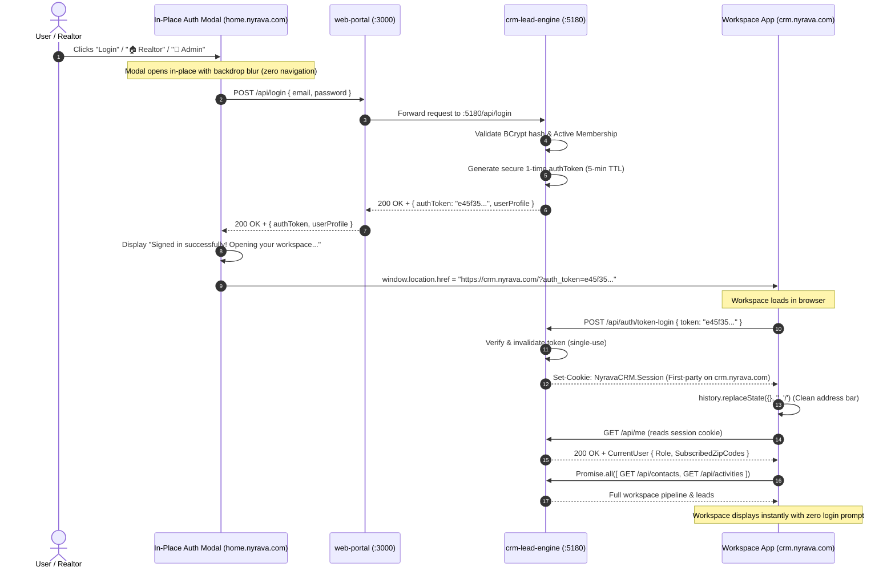
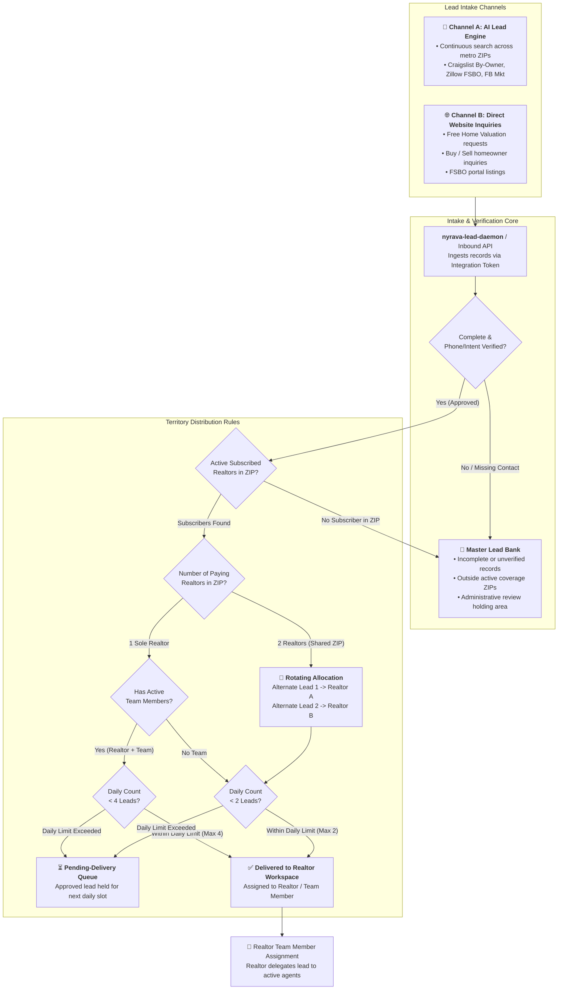
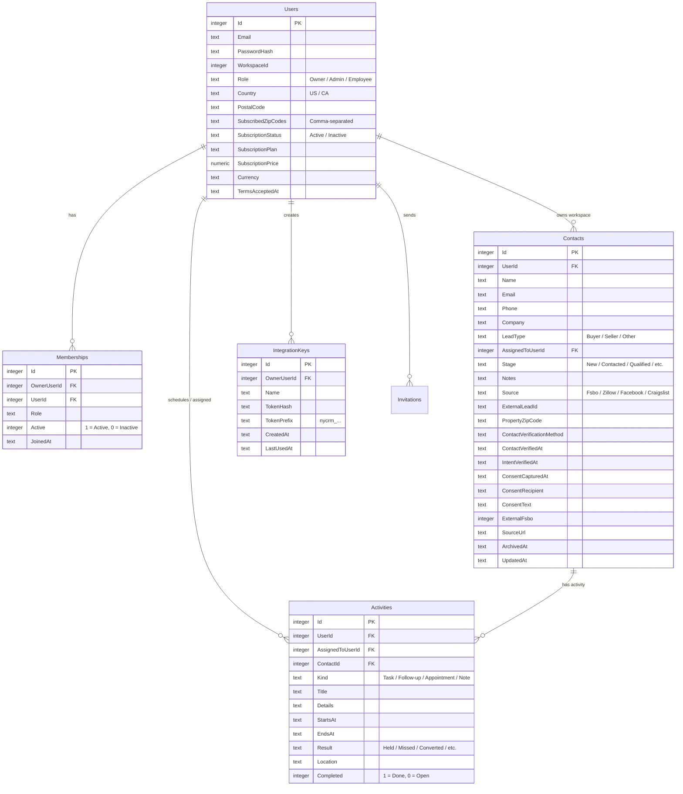

# Nyrava Home — System Architecture & Service Setup Diagram

**Platform:** `https://home.nyrava.com` &nbsp;|&nbsp; **Workspace:** `https://crm.nyrava.com`  
**Host IP:** `188.172.228.105` &nbsp;|&nbsp; **OS:** Debian 13 (Bookworm) &nbsp;|&nbsp; **Stack:** Docker Compose, Caddy 2, ASP.NET Core 8, Node.js 20, SQLite

---

## 1. High-Level Host & Container Topology

```mermaid
flowchart TD
    subgraph Internet ["🌐 Public Internet (Consumers & Realtors)"]
        BrowserHome["Visitor / Realtor<br/><b>home.nyrava.com</b>"]
        BrowserCRM["Realtor / Team / Admin<br/><b>crm.nyrava.com</b>"]
        BrowserVal["Valuation Consumer<br/><b>value.nyrava.com</b>"]
        BrowserMeet["Video Consultation<br/><b>meet.nyrava.com</b>"]
    end

    subgraph Host ["🖥️ Cloud Host: 188.172.228.105 (Debian 13)"]
        subgraph ProxyLayer ["🛡️ Edge Routing & Security (Ports 80 / 443)"]
            Caddy["<b>Caddy 2 Reverse Proxy</b><br/>• Automatic Let's Encrypt SSL<br/>• Gzip / Zstandard Compression<br/>• Subdomain Routing & WebSocket Upgrade"]
        end

        subgraph DockerNet ["🐳 Docker Bridge Network: nyrava-platform_default"]
            WebPortal["<b>web-portal</b> (Port 3000)<br/>• Node.js 20 / Express<br/>• Public Website & Landing Pages<br/>• In-Place Auth Popup Modal<br/>• Nyra Sales AI Bot Engine<br/>• Same-Origin API Proxy"]
            
            CRMLeadEngine["<b>crm-lead-engine</b> (Port 5180)<br/>• ASP.NET Core 8 / Kestrel (.NET)<br/>• Realtor & Team Professional Workspace<br/>• Master Lead Bank & Territory Engine<br/>• Single Sign-On (SSO) Token Provider<br/>• Entity Framework Core 8"]
            
            HomeValuation["<b>home-evaluation</b> (Port 5190)<br/>• Node.js 20 / Express<br/>• Instant Home Valuation Engine<br/>• 3-Year Equity Models & CMA<br/>• Direct Homeowner Inquiries"]
            
            MeetConsultation["<b>meet-consultation</b> (Port 5000)<br/>• Node.js 20 / Socket.io<br/>• WebRTC Signaling Gateway<br/>• Peer-to-Peer HD Video Consultation"]

            LeadDaemon["<b>nyrava-lead-daemon</b> (Background Worker)<br/>• Node.js 20 Worker<br/>• 30-Minute Ingestion Cron<br/>• Scraping Connectors (FSBO, Craigslist, Zillow)<br/>• Ingests via Integration Token into CRM"]
        end

        subgraph StorageLayer ["💾 Persistent Storage (Docker Named Volumes)"]
            VolCRM["<b>crm_db_data</b><br/>• nyrava-crm.db (SQLite 3)<br/>• Users, Leads, Activities, Invites"]
            VolCaddyData["<b>caddy_data</b><br/>• Let's Encrypt TLS Certificates"]
            VolCaddyCfg["<b>caddy_config</b><br/>• Caddy runtime cache"]
        end
    end

    BrowserHome -->|HTTPS 443| Caddy
    BrowserCRM -->|HTTPS 443| Caddy
    BrowserVal -->|HTTPS 443| Caddy
    BrowserMeet -->|HTTPS 443 (WSS)| Caddy

    Caddy -->|Proxy to :3000| WebPortal
    Caddy -->|Proxy to :5180| CRMLeadEngine
    Caddy -->|Proxy to :5190| HomeValuation
    Caddy -->|Proxy to :5000| MeetConsultation

    WebPortal -.->|Internal Auth / CRM API| CRMLeadEngine
    LeadDaemon -->|HTTP POST with nycrm_ token| CRMLeadEngine
    CRMLeadEngine <--> VolCRM
    Caddy <--> VolCaddyData
    Caddy <--> VolCaddyCfg
```

---

## 2. In-Place Authentication & Single Sign-On (SSO) Flow

When a user visits `https://home.nyrava.com` and clicks **Login**, **Realtor Login**, **Team Member Login**, or a 1-click test button, authentication executes seamlessly without browser cookie blocking.



---

## 3. Lead Generation, Intake & Territory Distribution Engine

The engine continuously processes opportunities according to the platform's business workflow rules:



---

## 4. Port, Protocol & Service Inventory

| Service Name | Container / Process | External Domain | Internal Port | Technology | Purpose |
|---|---|---|---|---|---|
| **proxy** | `nyrava-platform-proxy-1` | `*.nyrava.com` | `80`, `443` | Caddy 2 Alpine | Let's Encrypt TLS termination, edge proxying, header management |
| **web-portal** | `nyrava-platform-web-portal-1` | `home.nyrava.com` | `3000` | Node.js 20 / Express | Landing pages, in-place auth popup, AI guide bot (Nyra), API gateway |
| **crm-lead-engine** | `nyrava-platform-crm-lead-engine-1` | `crm.nyrava.com` | `5180` | ASP.NET Core 8 / Kestrel | Realtor workspace, lead bank, dispatching, SQLite EF Core, SSO |
| **home-evaluation** | `nyrava-platform-home-evaluation-1` | `value.nyrava.com` | `5190` | Node.js 20 / Express | Instant comparative market valuation, 3-year equity forecasting |
| **meet-consultation**| `nyrava-platform-meet-consultation-1` | `meet.nyrava.com` | `5000` | Node.js 20 / Socket.io | WebRTC peer-to-peer video rooms and signaling for client meetings |
| **nyrava-lead-daemon**| `nyrava-lead-daemon` | *Internal Only* | *Background* | Node.js 20 Worker | 30-minute automated scraping and lead injection worker |

---

## 5. Database Schema & Tables

Located on the server at:  
`/var/lib/docker/volumes/nyrava-platform_crm_db_data/_data/nyrava-crm.db`



---

## 6. Security & Data Protection Rules

1. **Lead Origin Privacy:**
   - Raw source listing URLs and scraping origins (`Craigslist`, `Zillow FSBO`, `Facebook Marketplace`) are strictly visible **only to the Platform Owner Admin** (`admin@home.nyrava.com`).
   - For subscribed Realtors and their employees, the source is automatically sanitized and branded as **Nyrava Private Direct Network** with verified homeowner phone/intent timestamps to protect proprietary lead generation methods.
2. **Territory Availability Cap:**
   - Maximum of **2 active subscribing Realtors** per ZIP code.
   - 1 sole Realtor with an active employee team can receive up to **4 leads/day**.
   - Shared ZIPs or Realtors without teams receive up to **2 leads/day**.
   - Excess approved leads wait in the **Pending-Delivery Queue** rather than being discarded.
3. **Session Cookies:**
   - Configured with `SameSite = Lax`, `Secure = Always`, `HttpOnly = true`, and scoped to `.nyrava.com` with one-time SSO token authentication.
