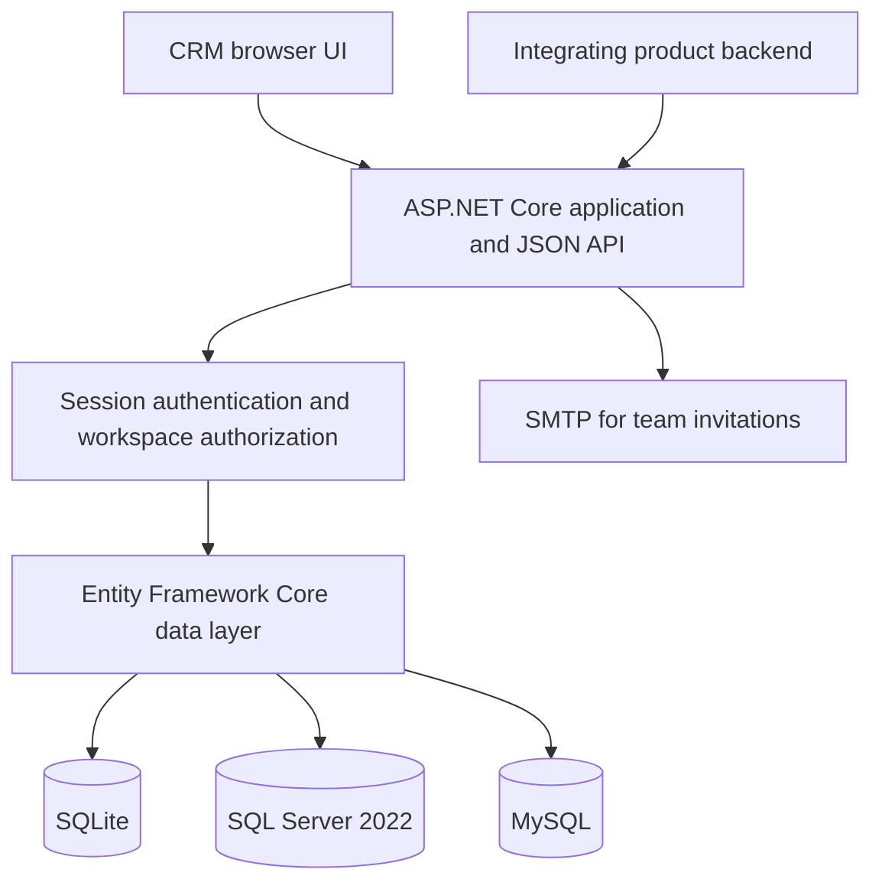

# Architecture overview

Nyrava CRM is a single ASP.NET Core application. The browser UI and approved integrating backends call its JSON API; authentication and workspace authorization are enforced by the server before data access.

## Request and data boundaries

- The browser interface is served by the application and calls same-origin `/api` endpoints.
- A session cookie identifies the signed-in person. The server resolves that person's role and workspace; callers cannot select a different workspace by sending an owner ID.
- Subscriber requests are scoped to the Subscriber's workspace. Team Member contact and activity access is additionally limited to records assigned to that member.
- Lead-source integration is optional. A Subscriber can issue a revocable bearer key scoped to their workspace; the versioned inbound endpoint creates only qualified, consented, already-routed leads in that workspace. It cannot select a tenant from request data.
- The connected lead system remains responsible for ZIP/territory and entitlement decisions, and for Admin review of questionable external FSBO candidates. The CRM requires an Admin review reference for external FSBO delivery, but does not provide the upstream review queue.
- Browser session authentication remains separate from machine-to-machine lead delivery. Do not use Subscriber passwords or integration keys in browser code.
- The database is private application storage. Do not expose it to browsers or unrelated applications; use the authenticated API so authorization rules remain in effect.
- SMTP is used for invitation delivery. In-app reminders and team chat do not depend on an external messaging provider.

## Hosting shape

The initial deployment can run the web application and one supported database on the same host. Use a dedicated, empty database for a new installation. For an internet-facing deployment, terminate HTTPS at a trusted reverse proxy, restrict database network access, configure secret storage, disable the demo profile, and test backup restoration and upgrades in staging.

## Current implementation notes

- `Program.cs` contains endpoint registration, request handlers, authentication setup, and startup database initialization.
- `CrmDb.cs` defines Entity Framework Core entities and database indexes.
- `wwwroot/` contains the browser UI and its API client.
- Startup creates the initial schema and applies a limited set of known compatibility additions. It is not a general-purpose migration framework; follow the backup and upgrade procedure in [Installation and deployment](INSTALLATION.md).
- The automated workflow restores and compiles the Release build, then runs integration tests for authentication, contact lifecycle and workspace isolation, appointment results, and note history. Database-provider compatibility and browser-level interaction still need separate verification.
